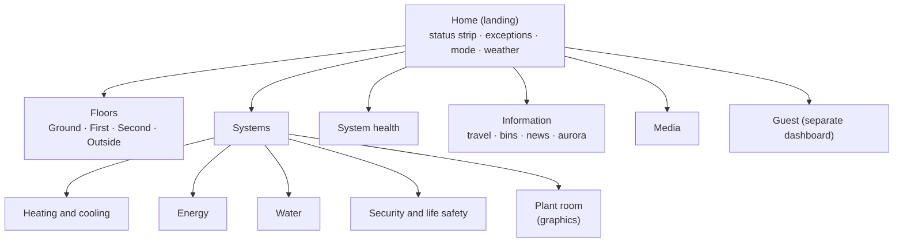

# 03 Dashboards

[← Back to README](../README.md)

## Principles (high-performance HMI)
- **Grey and neutral when normal.** Colour appears only for abnormal states: red = alarm, amber = warning, blue = informational. No decorative colour.
- **Overview first, detail one or two taps away.** The landing view answers "is everything OK?" in under five seconds.
- **The same thing looks the same everywhere** (one card type per point type).
- **Exceptions are listed, not hunted for:** offline devices, low batteries, paused automations and active alarms each have a list.
- **Stock cards first;** custom cards (HACS) only where they add real value, to keep upgrades safe.

## Hierarchy

The view-by-view map, with cards and status, is in [data/dashboard-map.csv](../data/dashboard-map.csv).

## The views

| View | Purpose | Key content |
|---|---|---|
| **Home (landing)** | Everything OK? | Status strip (mode, alarm, fire/CO, leaks, heating, energy now), **exceptions list** (offline, batteries < 20 %, paused automations, overrides), weather and warnings, next bin day |
| **Floors** | Where things are | Area cards per room: temperature, occupancy, lights, blinds, heating demand; tap through to the room |
| **Heating and cooling** | Comfort and plant | All 18 zones (setpoint vs actual, demand, override state), DHW temperatures, boiler state, aircon, IAQ per room |
| **Energy** | Cost and carbon | Import/export, tariff windows, carbon intensity, EV state, biggest loads, daily cost (absorbs the [energy dashboard](https://github.com/the-control-cabinet/home-energy-dashboard)) |
| **Water** | Usage and leaks | Existing water view: flow, pressure, per-draw, bills; leak sensors; stopcock note |
| **Security and life safety** | Protect | Fire/CO/fault status, alarm state, lock, garage, cameras, door events |
| **Plant room** | BMS-style schematic | Boiler, valves, cylinders, UFH from the [plant graphics repo](https://github.com/the-control-cabinet/plant-room-graphics-hmi) |
| **System health** | Head end | Integration availability, gateways, ESPHome uptime/resets, Zigbee link quality, host CPU/disk, backups ([head-end health](https://github.com/the-control-cabinet/head-end-health-monitoring)) |
| **Information** | Daily life | Rail departures, travel times, bins, news, sports, aurora, flights |
| **Media** | Entertainment | Music, TVs, speakers |
| **Guest** | Safe controls only | Lights, blinds and heating in guest rooms, a Wi-Fi details card; nothing security-related |

## Card toolkit

| Need | Card |
|---|---|
| A single point (state, toggle) | **Tile** (stock), with features for setpoint and brightness |
| A room | **Area** card (stock) with occupancy and temperature |
| A list of exceptions | **Entity filter** (stock) or auto-entities (HACS) |
| Trends | **History graph** (stock); ApexCharts (already used) for multi-axis |
| Gauges | Gauge (stock); Gauge Card Pro (already used on Water) |
| Floor plan | **Picture elements** over a simple line drawing per floor |
| Conditional alarms | Conditional cards: shown only when active |
| Layout | **Sections** view (stock) for every view |

## Two form factors
- **Phone:** one column; landing view plus systems; actionable notifications deep-link into the right view.
- **Wall panel** (optional, e.g. hall or kitchen): landing view only, large tiles, screen dims at night, no security controls without a PIN.
